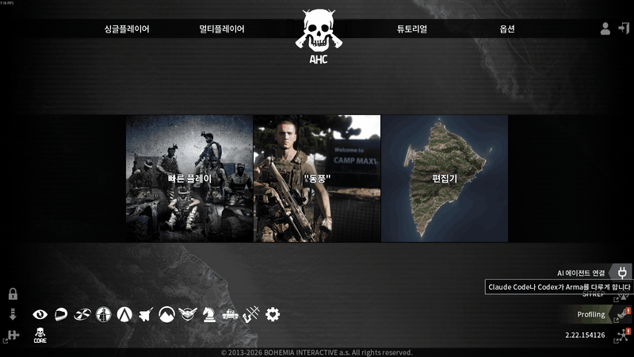

<div align="center">

# Arma-MCP

**말로 시키면 AI가 Arma 3를 띄우고, 돌리고, 확인합니다.**

Claude Code와 Codex를 Arma 3에 연결하는 MCP 서버입니다.

[](https://github.com/AHC-Clan/Arma-MCP/releases)
[](LICENSE)




</div>

## 시작하기

**1. 플러그인을 설치합니다.** 쓰는 앱의 명령을 터미널에 붙여 넣습니다.

Claude Code

```bash
claude plugin marketplace add https://github.com/AHC-Clan/Arma-MCP.git
claude plugin install arma-mcp@ahc
```

Codex

```bash
codex plugin marketplace add https://github.com/AHC-Clan/Arma-MCP.git
codex plugin add arma-mcp@ahc
```

게임 안에서 설치해도 됩니다. 메인 화면 오른쪽 아래 **AI 에이전트 연결**에서 **연결**을 누릅니다.

**2. Arma 3를 시작합니다.** [브리지 모드](https://github.com/AHC-Clan/Arma-MCP/releases/latest)를 받아 모드로 추가하고 **BattlEye 없이** 시작합니다.

**3. AI에게 말합니다.** 앱에서 새 대화를 열고 "Arma 상태 확인해 줘"라고 말합니다.

Node.js와 Git이 필요합니다. 자세한 내용은 [설치 안내](docs/install.md)에 있습니다.

## 할 수 있는 일

| 이렇게 말하면 | AI가 하는 일 |
|---|---|
| "VR 맵에 미션 띄우고 이 스크립트 돌려 봐" | 미션을 만들어 띄우고 SQF를 실행합니다 |
| "방금 로그에서 오류 찾아 줘" | RPT를 읽고 원인을 설명합니다 |
| "서버랑 클라이언트 띄워서 멀티로 시험해 줘" | 전용 서버와 클라이언트를 띄워 접속까지 합니다 |
| "지금 화면 보고 UI 깨졌는지 봐 줘" | 게임 화면을 찍어 직접 확인합니다 |

전체 목록은 [기능 안내](docs/features.md)에 있습니다.

## 문서

| 문서 | 내용 |
|---|---|
| [설치](docs/install.md) | 명령어 설치, 자동 업데이트, 원격 PC |
| [기능](docs/features.md) | 기능 목록과 사용 흐름 |
| [설정](docs/configuration.md) | 설정 파일, 모드 경로, 웹 게시 |
| [도구 레퍼런스](docs/tools.md) | MCP 도구 전체 |
| [CLI](docs/cli.md) | 셸에서 쓰는 `arma-mcp` 명령 |
| [개발](docs/development.md) | 구조, 빌드, 릴리스 |

## 라이선스

[MIT](LICENSE)
